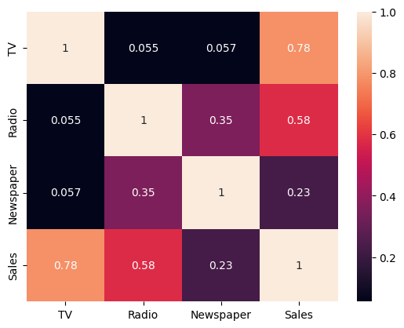
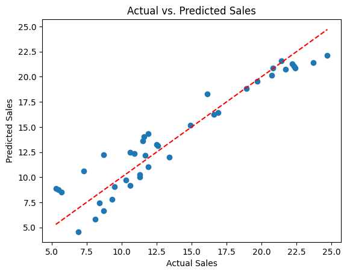
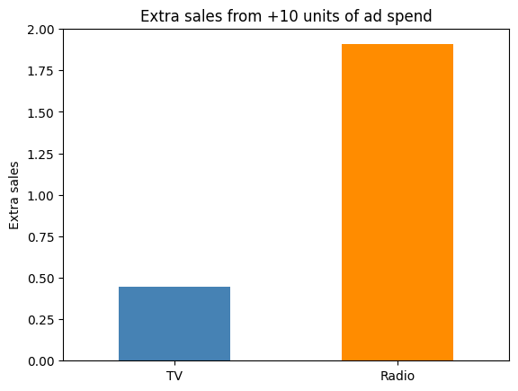

# Sales Prediction using Python

Predicting sales from advertising spend on TV, Radio and Newspaper with linear regression, then using the model to show how changes in spend affect sales and where a marketing budget works hardest.

Completed for CodeAlpha (Task 4: Sales Prediction using Python).

## Overview

This project covers the full workflow: data cleaning, exploratory analysis, feature selection, model building and evaluation, and a what-if analysis of advertising changes, ending with recommendations for marketing strategy.

## Dataset

- **Source:** Kaggle, [Advertising](https://www.kaggle.com/datasets/bumba5341/advertisingcsv) (`bumba5341/advertisingcsv`)
- **Size:** 200 records, 4 columns after dropping an unnecessary index column
- **Features:** `TV`, `Radio`, `Newspaper` (advertising spend)
- **Target:** `Sales`
- **Quality:** no missing values, no duplicates

## Approach

1. **Data cleaning:** checked missing values, duplicates and data types, removed the index column, and inspected outliers with a boxplot (kept, since there are only 200 rows).
2. **Exploratory data analysis:** summary statistics, pairplot and a correlation heatmap.
3. **Feature selection:** correlation with Sales and VIF to check multicollinearity (all VIF values close to 1). Scaling and encoding were not needed.
4. **Modelling:** 80/20 train/test split, then linear regression.
5. **Evaluation:** R², MAE, MSE and RMSE on the test set, a train vs. test comparison to check for overfitting, and an actual vs. predicted plot.
6. **Feature check:** compared the model with and without Newspaper.
7. **Impact analysis:** what-if scenarios on the final model to measure how changes in spend change predicted sales.

## Results

| Model | Test R² | Test RMSE |
|---|---|---|
| TV + Radio + Newspaper | 0.8994 | 1.7816 |
| **TV + Radio (final)** | **0.9006** | **1.7714** |

- The final model explains about 90% of the variance in Sales. Its RMSE of about 1.77 is small next to the Sales standard deviation of about 5.2.
- Train and test R² are almost identical (0.896 vs. 0.899), so there is no sign of overfitting.
- Dropping Newspaper does not hurt accuracy, so the final model uses TV and Radio only.

**Final model coefficients:** intercept 3.03, TV 0.0447, Radio 0.1907.

## Key Insights

- **Radio is the most efficient channel.** Per 10 extra units of spend, Radio adds about 1.91 sales versus 0.45 for TV, roughly four times the return per unit of budget.
- **TV is still a major driver overall.** It correlates most strongly with Sales (0.78) because TV spend varies much more across the data, so even a small per-unit effect adds up.
- **Newspaper adds no measurable value.** Its coefficient is close to zero and removing it did not reduce accuracy.
- **Reallocation helps.** Moving 10 units of budget from TV to Radio is predicted to raise sales by about 1.46 without increasing total spend.
- **Same-budget comparison:** with 230 units of total spend, a plan with TV 185 / Radio 45 is predicted to sell about 19.88, versus 17.69 for TV 200 / Radio 30.

## Visuals







## Recommendations

- Move part of the budget from Newspaper (and possibly some TV) into Radio.
- Keep TV as the base channel, but treat it as the lower-return channel per unit.
- Cut or test reducing Newspaper spending.

## Limitations

- The model is linear, so it assumes constant returns. Real advertising has diminishing returns, so predictions should only be trusted within the spend ranges in the data (Radio goes up to about 50).
- The dataset has only 200 rows and shows correlation, not proven causation.
- TV and Radio may reinforce each other, which this simple model cannot capture. A TV x Radio interaction term or a Random Forest would be a good next step.
- The dataset has no platform or customer segment columns, so conclusions are at the channel level only.

## Tech Stack

Python, pandas, NumPy, Matplotlib, Seaborn, statsmodels, scikit-learn, kagglehub

## How to Run

**Option 1: Google Colab (easiest).** Go to colab.research.google.com, choose **File > Open notebook > GitHub**, paste this repo's link, open the notebook, then choose Runtime > Run all.

**Option 2: On your own computer.** Click the green **Code** button on this page and choose **Download ZIP**. Unzip it, then in a terminal inside the folder run:

```bash
pip install -r requirements.txt
jupyter notebook Sales_Prediction_using_Python.ipynb
```

The notebook downloads the dataset automatically with `kagglehub`. If that fails on your setup, download `Advertising.csv` from the Kaggle page above and update the file path in the "Data Loading" section.

## Repository Structure

```
.
├── Sales_Prediction_using_Python.ipynb
├── README.md
├── requirements.txt
├── correlation_heatmap.png
├── actual_vs_predicted.png
└── extra_sales_bar.png
```

## Author

**Cherish Akhigbe**
[LinkedIn](<https://www.linkedin.com/in/akhigbe-cherish>)
